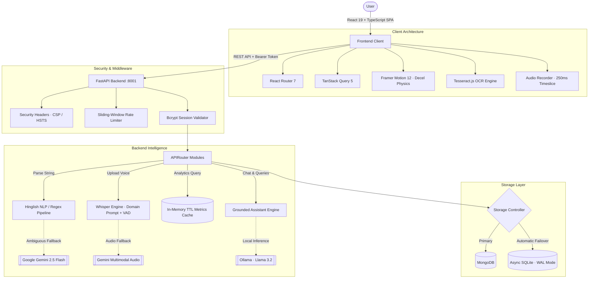

# Batua — Intelligent, Local-First Personal Finance Vault

[](https://github.com/anshuldhiman-ai/Batua/actions)
[](https://www.python.org)
[](https://fastapi.tiangolo.com)
[](https://react.dev)
[](https://www.typescriptlang.org)
[](https://vitejs.dev)
[](https://tailwindcss.com)
[%20%7C%20MongoDB-4EA94B?logo=sqlite&logoColor=white)](https://sqlite.org)
[](#-license)

> **Batua** (*बटुआ* — wallet, in Hindi) is a private, local-first personal finance platform. Type or speak an expense in plain English or Hinglish — `swiggy 320 upi` or `aaj lays k 2 packet ek 10 ka ek 20 ka aur chai 10` — and Batua parses, categorises, forecasts, and visualises your cash flow. 
>
> Equipped with on-device speech transcription (**faster-whisper**), local LLM reasoning (**Ollama**), bcrypt session security, sliding-window rate limiting, and an embedded SQLite database, your financial records **never leave your device**.

<p align="center">
  <video src="demo.gif.mp4" width="100%" style="max-width: 820px; border-radius: 12px; border: 1px solid rgba(255,255,255,0.1);" controls autoplay loop muted></video>
</p>

---

## Table of Contents

- [Core Value Proposition](#-core-value-proposition)
- [Feature Highlights](#-feature-highlights)
- [System Architecture](#-system-architecture)
- [Engineering & Security Highlights](#-engineering--security-highlights)
- [Tech Stack](#-tech-stack)
- [Quick Start](#-quick-start)
- [Configuration Reference](#-configuration-reference)
- [API Surface](#-api-surface)
- [Project Directory Structure](#-project-directory-structure)
- [Verification & Testing](#-verification--testing)
- [Deployment](#-deployment)
- [License](#-license)

---

## 💎 Core Value Proposition

| Pillar | Description |
|---|---|
| 🧠 **Natural-Language & Multi-Item Hinglish** | Log expenses conversational-style with smart history autocomplete. A high-speed local regex/NLP parser splits compound Hinglish sentences into individual debit/credit items with arithmetic breakdowns (`₹15*2+₹20`). |
| 🎙️ **Resilient Multi-Tier Speech Engine** | 100% offline speech recognition via **faster-whisper** with domain vocabulary conditioning and VAD filtering, coupled with automatic fallback to Gemini Multimodal Audio and the browser Web Speech API. |
| 🔒 **Local Vault Security & Zero Telemetry** | Single-user vault protected by bcrypt password hashing, sliding-window rate limiting on auth/AI routes, tab-throttled polling, and an explicit Privacy Pledge. Zero third-party cookies, tracking, or telemetry. |
| ♻️ **Zero-Config Dual Storage Engine** | Connects to MongoDB when available and automatically hot-fails-over to an embedded asynchronous SQLite database (`aiosqlite` with WAL mode and schema auto-migrations). Run immediately without setting up external databases. |
| 📊 **Predictive ML & Decision Intelligence** | Real-time cash-flow projections, automated spending-pattern clustering, anomaly detection, category budget optimization, and savings goal trackers powered by `scikit-learn`. |
| 🎨 **High-Conversion Visual System** | Engineered with strict visual tokens: non-linear deceleration curves (`cubic-bezier(0.22, 1, 0.36, 1)`), typographic text-wrap balance, mathematical nested radii ($\text{inner} = \text{outer} - \text{gap}$), and print-ready Paper White / Executive Dark monthly statement generators. |

---

## 🎯 Feature Highlights

### 1. Smart Capture & Input
- **Autocomplete Natural Language Input:** Begin typing to see instant fuzzy matches from previous transaction descriptions. Press `Enter` to select and fill; press `Enter` again to parse. Supports natural dates (`yesterday`, `last friday`, `12th june`).
- **Explicit Direction Controls:** Force credits or debits using prefix signs (e.g. `gift -500` remains a debit, `salary +85000` is a credit). Contextual inference automatically routes income keywords (*salary*, *dividend*, *refund*) to credits.
- **Hinglish Multi-Transaction Parser:** Dictate or paste sentences like *"aaj petrol 200 aur dmart groceries 1450 upi"*; the parser automatically splits them into distinct entries with correct categories, payment methods, and timestamps.
- **Multi-Tier Voice Recognition (STT):**
  - **Tier 1 (Local Whisper):** Runs offline using `faster-whisper` (default model `small`, switchable to `tiny`/`base`/`medium`), conditioned with Indian expense vocabulary and Voice Activity Detection (VAD).
  - **Tier 2 (Cloud Multimodal Fallback):** Automatically leverages Google Gemini Multimodal Audio if Whisper is unavailable or audio volume is low.
  - **Tier 3 (Web Speech API):** Live client-side speech recognition with continuous fallback guards.
  - **Mic Test Utility:** Integrated in Settings with real-time waveform level monitors, audio playback verification, and model pre-warming.
- **Receipt OCR Scanner:** Capture or upload photo receipts; client-side Tesseract.js and Gemini Vision extract items, taxes, totals, and merchant names directly into the staging table.
- **Spreadsheet Import & Arithmetic Evaluation:** Import `.xlsx` or `.csv` statements with automatic column mapping, staged progress updates, 25 MB file guards, and SHA-256 fingerprint deduplication. Cell arithmetic (e.g. `120+240` or `₹15*2+₹20`) is evaluated and preserved verbatim.

### 2. Analytics & Visualizations
- **Interactive Financial Timeline:** Continuous and bar-based cash flow tracking across custom date ranges, single months, and preset quarters.
- **Category & Merchant Deep Dives:** Treemaps, category distribution rings, top merchant bar charts, and payment method breakdowns (UPI, Cash, Credit Card, Net Banking).
- **GitHub-Style Spending Heatmap:** Day-by-day intensity matrix reflecting expense frequency and volume throughout the year.
- **KPI Metrics:** Month-over-month income, expense, net burn rate, and savings rate deltas.
- **Fine-Grained Food Classification:** Splits general food into dedicated subcategories: Food & Dining, Fast Food, Snacks, Fruits, Refreshments, and Beverages.

### 3. People & Debt Ledger (Udhar Tracker)
- **Track Borrowed & Lent Funds:** Maintain dedicated ledgers for contacts ("You gave" vs. "You took").
- **Real-Time Net Positions:** Instant aggregation of pending receivables, payables, and net debt.
- **One-Click Settlements:** Mark transactions partially or completely settled with full audit trail history.

### 4. Budgets & Financial Goals
- **Category Budgets:** Set monthly allowances per category with real-time progress indicators and warning states.
- **Savings Goals:** Define target funds with milestone dates, visual progress rings, and ML-recommended monthly contribution targets.

### 5. Statements & Export
- **Print-Ready Monthly Statement Modal:** Interactive statement viewer featuring "Month View" and "Custom Timeline" modes.
- **Document Themes:** Switch between **Paper White** (clean, high-contrast light document optimized for printing/PDF export) and **Executive Dark**.
- **Native PDF Generation:** One-click `window.print` trigger formatted for standard A4 document layout.
- **Stacked Monthly Excel Sheets:** Export stacked workbook tables (`Expense Table : MM/YYYY`) featuring navy blue title banners, zebra-striped rows, currency formatting, and debits-only totals.

### 6. Conversational Financial Assistant
- **Grounded Q&A Engine:** Ask natural questions (*"How much did I spend on dining out last month compared to July?"*).
- **Zero-Hallucination RAG:** Synthesizes verified numbers directly from your local SQLite/Mongo store and passes strict grounding prompts to Ollama (`llama3.2`) or Gemini for natural responses. Degrades gracefully to rule-based templates if offline.

---

## 🏗 System Architecture

Batua follows an offline-first, decoupled architecture engineered for sub-100ms response times:



---

## 🔬 Engineering & Security Highlights

### 1. Dual-Database Hot Failover
On startup, Batua probes MongoDB with a 1.5-second timeout. If MongoDB is absent or unreachable, it immediately falls back to asynchronous SQLite (`aiosqlite`) configured with Write-Ahead Logging (`PRAGMA journal_mode=WAL`) and `NORMAL` synchronous flags. Both engines implement the identical asynchronous repository interface (`all`, `get`, `insert`, `update`, `delete`, `query`), allowing seamless zero-config local operation that can be promoted to cloud MongoDB Atlas via a single environment variable.

### 2. Multi-Tier Speech-to-Text Pipeline
Voice recordings are captured client-side in timesliced 250ms chunks (`MediaRecorder.start(250)`), preventing empty or truncated audio payloads. Axios request interceptors dynamically omit default JSON content headers to preserve native browser multipart boundaries. Uploads are processed by `faster-whisper` using domain vocabulary hints (`"chai 20 rupees, auto 50 cash, groceries 200 UPI, Swiggy, Zomato..."`) and Voice Activity Detection (VAD) to filter background noise. If local Whisper is not installed or audio is silent, the backend routes the clip to Google Gemini Multimodal Audio before falling back to browser Web Speech.

### 3. Sliding-Window Rate Limiting
To protect against brute-force attacks and resource exhaustion when self-hosted or deployed to cloud platforms, Batua implements an in-memory sliding-window rate limiter (`backend/app/rate_limiter.py`). Client IPs are extracted using reverse-proxy headers (`CF-Connecting-IP`, `X-Forwarded-For`).
- `/api/auth/login`: 10 attempts/minute (reset on success).
- `/api/auth/register`: 5 attempts/minute.
- `/api/auth/forgot-password`: 5 attempts/minute.
- `/api/insights/refresh`: 4 calls/minute.
Exceeded limits return HTTP 429 with standard `Retry-After` response headers.

### 4. Background Polling Optimization
The frontend background health checks in `OfflineBanner.tsx` inspect `document.visibilityState`. When the user minimizes or navigates away from the browser tab, polling intervals halt automatically, eliminating CPU wakeups and server request spam.

### 5. High-Conversion Visual System
Batua integrates the `landing-page-design` design specifications:
- **Deceleration Physics:** Replaces default browser easing with `cubic-bezier(0.22, 1, 0.36, 1)` mapped to `ease-decel`.
- **Typographic Scale & Balance:** Prohibits arbitrary font sizes, enforcing strict Tailwind step tokens alongside `text-wrap: balance` for headings and `text-wrap: pretty` for body paragraphs.
- **Nested Radius Hierarchy:** Enforces $\text{inner radius} = \text{outer radius} - \text{gap}$ across cards, modals, and input fields.
- **Tactile Feedback:** Incorporates `active:scale-[0.98]` physical depression responses on interactive buttons and dashboard cards.

---

## 🧰 Tech Stack

| Domain | Technologies |
|---|---|
| **Backend Framework** | FastAPI 0.115 · Uvicorn 0.34 · Pydantic v2.13 · Python 3.11+ |
| **Storage & Persistence** | aiosqlite 0.22 · SQLModel · Motor 3.6 (Async MongoDB) · PyMongo · OpenPyXL · XlsxWriter |
| **Speech & Vision** | faster-whisper 1.2 · PyAV / ffmpeg · Tesseract.js 7 · Google Generative AI (Gemini 2.5 Flash) |
| **AI / NLP / ML** | Ollama (`llama3.2`) · scikit-learn 1.6 · spaCy 3.8 · NumPy 2.2 · Pandas 2.2 |
| **Security & Auth** | Passlib · Bcrypt 4.0 · Custom Sliding-Window Rate Limiter · CSP / HSTS Security Headers |
| **Frontend Framework** | React 19 · TypeScript 5.6 · Vite 6 · React Router 7 · TanStack React Query 5 |
| **Styling & Motion** | Tailwind CSS 3.4 · Framer Motion 12 · Tailwind Animate · Lucide Icons · Sonner Toasts |
| **Data Visualization** | Recharts 2.15 |
| **Quality & Testing** | Pytest 8.3 · pytest-asyncio · Ruff 0.9 · Vitest 4.1 · Testing Library React 16 |

---

## 🚀 Quick Start

### Prerequisites
- **Python 3.11+**
- **Node.js 18+** (Node 20+ recommended)
- *Optional:* [Ollama](https://ollama.com) (for offline local LLM assistant)
- *Optional:* MongoDB (defaults to embedded SQLite automatically)

### 1. Clone & Setup Configuration
```bash
git clone https://github.com/anshuldhiman-ai/Batua.git
cd Batua
cp .env.example .env
```

### 2. Launch the Backend
```bash
cd backend
python -m venv .venv

# On Linux/macOS:
source .venv/bin/activate
# On Windows (PowerShell):
.venv\Scripts\Activate.ps1

pip install -r requirements.txt
python -m uvicorn server:app --host 0.0.0.0 --port 8001 --reload
```
The backend initializes at **http://localhost:8001** (Health check: `http://localhost:8001/api/`).

### 3. Launch the Frontend
```bash
cd ../frontend
npm install
npm run dev
```
The frontend launches at **http://localhost:3000** and automatically proxies `/api` calls to the backend.

> 💡 **Windows 1-Click Launchers:** You can double-click `run-backend.bat` and `run-frontend.bat` (or `run-all.bat`) in the project root to start both environments automatically.

### 4. Enable Local AI Assistant (Optional)
```bash
ollama pull llama3.2
```
Batua automatically detects Ollama running at `http://localhost:11434`. If unavailable, the conversational assistant falls back to deterministic rule templates.

---

## ⚙️ Configuration Reference

All settings reside in the root `.env` file shared by both backend and frontend:

```ini
# ── Storage ─────────────────────────────────────────────────────────────
# If MongoDB is unreachable, Batua hot-fails-over to backend/data/store.db
MONGO_URL="mongodb://localhost:27017"
DB_NAME="batua"

# ── Security & Networking ──────────────────────────────────────────────
# In production, set to your exact domain (e.g. "https://batua.yourdomain.com")
CORS_ORIGINS="*"
ENABLE_DOCS="0"              # Set to "1" to expose /docs, /redoc, /openapi.json

# ── Cloud AI (Optional) ─────────────────────────────────────────────────
# Get your free key at https://aistudio.google.com/
GOOGLE_API_KEY=""
GEMINI_MODEL="gemini-2.5-flash"

# ── Local LLM (Optional) ────────────────────────────────────────────────
LOCAL_LLM_URL="http://localhost:11434"
LOCAL_LLM_MODEL="llama3.2"
LOCAL_LLM_ENABLED="1"

# ── Client Config (Vite) ────────────────────────────────────────────────
VITE_BACKEND_URL="http://localhost:8001"
```

---

## 🔌 API Surface

All backend services are exposed under `/api`:

| Domain | Key Endpoints | Description |
|---|---|---|
| **Auth** | `POST /api/auth/register`<br>`POST /api/auth/login`<br>`POST /api/auth/forgot-password`<br>`GET /api/auth/status`<br>`POST /api/auth/logout` | Bcrypt-hashed vault authentication with sliding-window brute-force rate limits. |
| **Transactions** | `GET /api/transactions`<br>`POST /api/transactions`<br>`PUT /api/transactions/{id}`<br>`DELETE /api/transactions/{id}`<br>`POST /api/transactions/bulk-delete` | CRUD ledger operations, batch deletes, and pagination filtering. |
| **NL Parser** | `POST /api/parse-nl`<br>`POST /api/parse-nl/bulk`<br>`POST /api/parse-nl/voice` | Rule-based Hinglish entity extraction with optional Gemini fallback. |
| **Voice / STT** | `GET /api/transcribe/status`<br>`POST /api/transcribe`<br>`POST /api/transcribe/test`<br>`POST /api/transcribe/model`<br>`POST /api/transcribe/warm` | Faster-whisper on-device transcription with Gemini audio fallback and model controls. |
| **Analytics** | `GET /api/analytics/timeline`<br>`GET /api/analytics/category-breakdown`<br>`GET /api/analytics/top-merchants`<br>`GET /api/analytics/heatmap`<br>`GET /api/analytics/treemap` | Single-pass monthly aggregations served through an in-memory TTL cache. |
| **Dashboard** | `GET /api/dashboard/metrics` | Real-time calculation of Income, Expense, Net Savings, and MoM deltas. |
| **People** | `GET /api/people`<br>`POST /api/people`<br>`POST /api/people/{id}/settle`<br>`GET /api/people/summary` | Contact-based borrowed/lent balance tracking and settlement accounting. |
| **Budgets** | `GET /api/budgets`<br>`POST /api/budgets`<br>`GET /api/budgets/status` | Category allowance definitions and threshold utilization tracking. |
| **Goals** | `GET /api/goals`<br>`POST /api/goals`<br>`PUT /api/goals/{id}`<br>`DELETE /api/goals/{id}` | Target savings tracker with automated monthly installment recommendations. |
| **ML Features** | `GET /api/ml/cash-flow-forecast`<br>`GET /api/ml/spending-patterns`<br>`GET /api/ml/anomalies`<br>`POST /api/ml/qa` | Scikit-learn predictive forecasting, clustering, and grounded RAG assistant. |
| **Import / Export** | `POST /api/upload-excel`<br>`GET /api/export/excel`<br>`GET /api/export/csv`<br>`GET /api/export/months` | File import processing, progress polling, and multi-month stacked Excel sheets. |
| **Settings** | `GET /api/settings/db-health`<br>`POST /api/settings/db-vacuum`<br>`POST /api/settings/seed-demo-data` | SQLite integrity verification, database compaction, and realistic demo seeding. |

*Note: Set `ENABLE_DOCS=1` in `.env` to view interactive OpenAPI Swagger documentation at `http://localhost:8001/docs` or the themed in-app reference at `http://localhost:3000/api-docs`.*

---

## 📂 Project Directory Structure

```text
batua/
├── backend/
│   ├── server.py              # Main ASGI app: lifecycle, routers, error handling
│   ├── storage.py             # Dual MongoDB/SQLite controller with unified async interface
│   ├── ai.py                  # Google Gemini API wrapper with graceful fallback
│   ├── local_llm.py           # Ollama client and conversational prompt builder
│   ├── chat_engine.py         # Multi-turn conversational session engine
│   ├── parser.py              # Regex and heuristic natural language parser
│   ├── transcribe.py          # Faster-whisper local STT with VAD and domain prompt
│   ├── ml_nlp.py              # ML transaction classifier (spaCy + scikit-learn)
│   ├── ml_analytics.py        # Spending clustering, cash-flow forecast, anomaly detection
│   ├── ml_goals.py            # Savings goals recommendation model
│   ├── ml_rag.py              # Grounded transaction Q&A synthesis
│   ├── excel_loader.py        # Multi-format spreadsheet parser with arithmetic evaluator
│   ├── app/
│   │   ├── models.py          # Pydantic data schemas
│   │   ├── cache.py           # In-memory TTL analytics cache
│   │   ├── rate_limiter.py    # Sliding-window IP rate limiter
│   │   ├── dependencies.py    # FastAPI storage injection
│   │   └── routes/            # Modular domain route controllers (auth, txns, analytics, etc.)
│   └── tests/                 # 43+ test suite (test_server.py, test_async_offload.py, etc.)
├── frontend/
│   ├── src/
│   │   ├── components/        # Layout, NLInputBar, KPICard, MonthlyStatementModal, etc.
│   │   ├── components/ui/     # Modular design primitives (Dialog, Tabs, Auth, Card)
│   │   ├── pages/             # Dashboard, Analytics, Transactions, Budgets, People, Goals, Settings
│   │   ├── hooks/             # Custom React hooks (useAnalyticsData, useDebounce, etc.)
│   │   ├── lib/               # Utility finance helpers, themes, motion presets
│   │   └── fonts/             # Brand typefaces (Nevera, Rostex)
│   ├── package.json           # React 19, Vite 6, Tailwind 3.4, Vitest 4.1
│   ├── tailwind.config.js     # Custom design tokens & decel easing curves
│   └── vite.config.js         # Build tooling & backend proxy configuration
├── .agents/skills/            # Agent design and offline engineering instructions
├── run-all.bat                # Windows 1-click concurrent runner
├── run-backend.bat            # Windows 1-click backend runner
├── run-frontend.bat           # Windows 1-click frontend runner
├── DEPLOYMENT.md              # Cloud deployment guide (Render + Vercel)
├── AGENTS.md                  # Development instructions & design rules
└── README.md
```

---

## 🧪 Verification & Testing

Batua maintains rigorous test coverage across both backend and frontend layers:

### Running Backend Tests
```bash
cd backend
# Run full route and integration suite
pytest tests/test_server.py -v

# Run code style & linting check
ruff check .
```
- **Coverage:** 43 comprehensive integration tests verifying auth rate limits, session management, transaction CRUD, arithmetic spreadsheet parsing, dual-database hot failover, and event-loop non-blocking thread execution.

### Running Frontend Tests
```bash
cd frontend
# Run vitest suite
npm test

# Run production bundle build check
npm run build
```
- **Coverage:** 229 component and unit tests across 18 test files verifying UI rendering, form validations, navigation behavior, tour steps, and financial calculations.

---

## ☁️ Deployment

- **Backend:** Ready for deployment on [Render](https://render.com) using the included `render.yaml` blueprint. Specify `MONGO_URL`, `CORS_ORIGINS`, and optional `GOOGLE_API_KEY` in environment variables.
- **Frontend:** Optimized for [Vercel](https://vercel.com) using the Vite framework preset with clean SPA rewrites in `frontend/vercel.json`.
- **Self-Hosted:** Can be containerized or run behind Nginx/Caddy with SSL termination. Rate limiting and proxy headers (`X-Forwarded-For`) are handled automatically.

Consult [`DEPLOYMENT.md`](DEPLOYMENT.md) for step-by-step production instructions.

---

## 📄 License

Distributed under the **MIT License**. See [`LICENSE`](LICENSE) for complete terms.

<p align="center">
  <sub>Designed & engineered for privacy-conscious individuals who demand complete ownership of their financial records.</sub>
</p>
